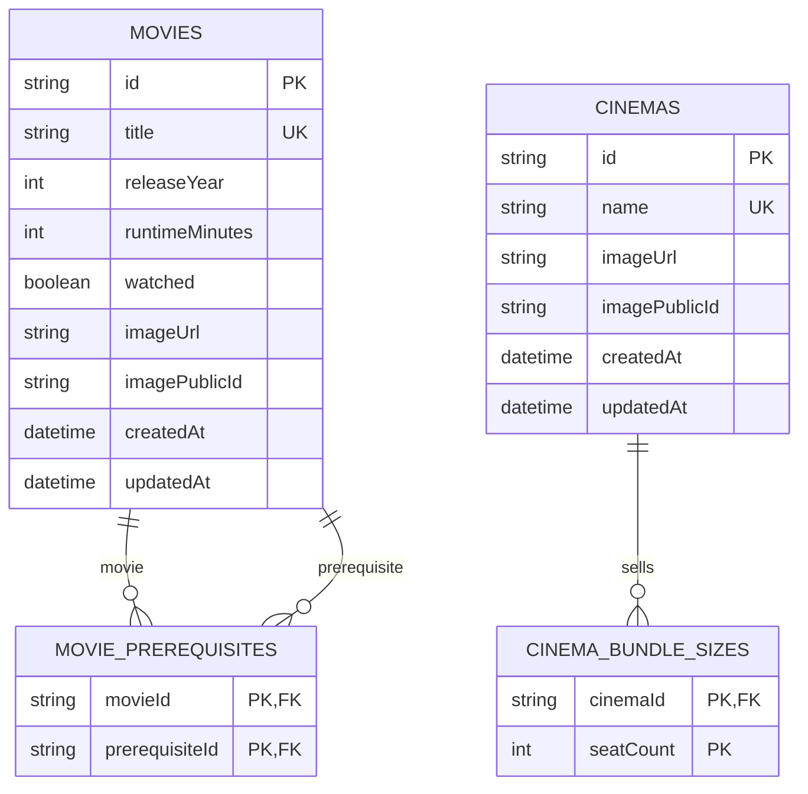

# CineQuest

**Plan Your Rewatch. Book Your Premiere.**

CineQuest is a movie rewatch planning and cinema booking platform that helps fans discover watch orders, track their progress, and organize opening-night group bookings.

This repository contains the backend API. The core feature logic is hand-written in `src/app/utils/graph.ts` (prerequisite traversal and cycle checks) and `src/app/utils/bundle.ts` (minimum-bundle booking quote), without solver libraries.

## Requirements Covered

- Movies with unique title, release year, runtime, optional prerequisites, and watched state.
- Cycle rejection with `409 CIRCULAR_DEPENDENCY` on create and update.
- Rewatch order with each prerequisite exactly once, topological ordering, target excluded, watched count, and unwatched runtime.
- Cinemas with unique name and 1–10 unique bundle sizes from 1–500 seats.
- Booking quotes for group sizes 1–10000 using the fewest exact bundles, or an explicit impossible result.
- All required endpoints under `/api`.

## API Reference

| Method | Path | Purpose |
|---|---|---|
| POST | `/api/movies` | Create a movie |
| GET | `/api/movies` | List movies |
| PATCH | `/api/movies/:id` | Update watched state, prerequisites, and other movie fields |
| DELETE | `/api/movies/:id` | Delete a movie and clean up prerequisite links |
| GET | `/api/movies/:id/rewatch-order` | Get ordered prerequisites with progress summary |
| POST | `/api/cinemas` | Create a cinema |
| GET | `/api/cinemas` | List cinemas |
| GET | `/api/cinemas/:id/booking?groupSize=6` | Get a booking quote |

`GET /health` is available for health checks.

## Run Locally

```bash
bun install
cp .env.example .env
bun run db:generate
bun run db:migrate
bun run db:seed
bun run dev
```

On Windows PowerShell, use `Copy-Item .env.example .env` instead of `cp`.

The demo seed adds 8 movies with prerequisite links and 3 cinemas with bundle sizes. It is manual by default; set `SEED_ON_START=true` only when you want it to run on boot. Re-running the seed resets demo movie watched states, demo prerequisite links, and demo cinema bundle sizes.

## Docker Compose

```bash
docker compose up --build
```

This starts PostgreSQL and the API, applies migrations, seeds demo data, and serves the API at `http://localhost:5000/api`.

## Useful Commands

```bash
bun run typecheck
bun run build
bun run format:check
bun run lint:check
bun run db:studio
```

## Assumptions

- `API_PREFIX` is `/api` to match the assessment exactly; no version suffix is used.
- Release year is validated as 1888–2100, using 1888 as the first practical film year.
- Runtime is validated as 1–300 minutes, as specified.
- Movie titles and cinema names are limited to 200 characters.
- IDs are UUID strings. Prerequisite IDs may be sent as a JSON array or a comma-separated string.
- `watched` defaults to `false`; it may be set on create or changed with `PATCH /movies/:id`.
- An impossible booking is a successful request with `possible: false` and a clear message.
- Error responses include `code` and `statusCode` so clients can handle `CIRCULAR_DEPENDENCY` reliably.
- Removed or changed prerequisites are validated before any write. Direct concurrent updates are not serialized by a database-level cycle constraint.

## AI Usage

AI tools were used for requirement extraction, implementation review, edge-case test planning, and documentation drafting. The final code was reviewed manually, and the feature logic for dependency ordering and bundle optimization was implemented directly in the repository as described above.

## Data Model


